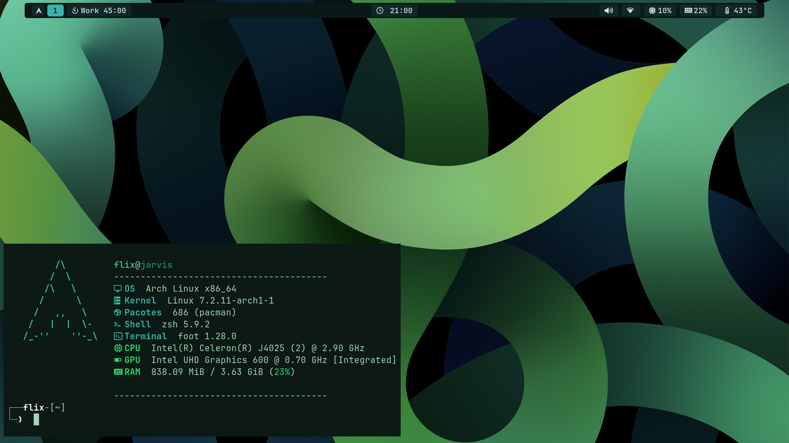
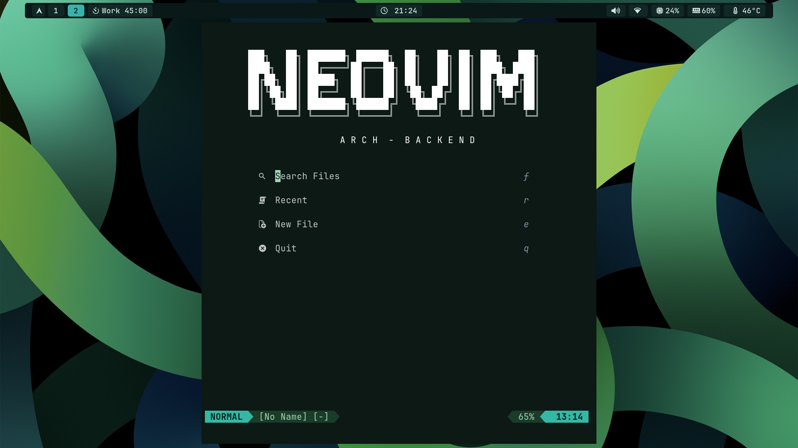
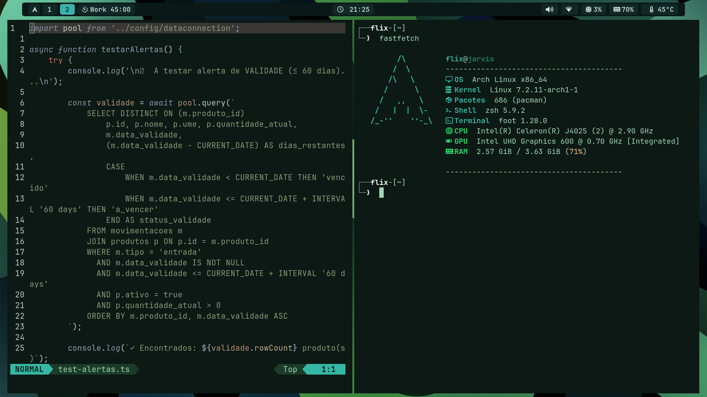
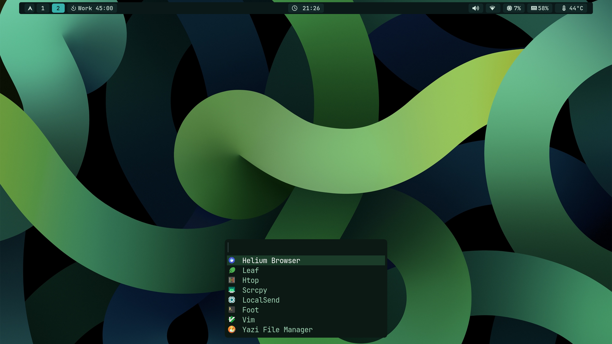
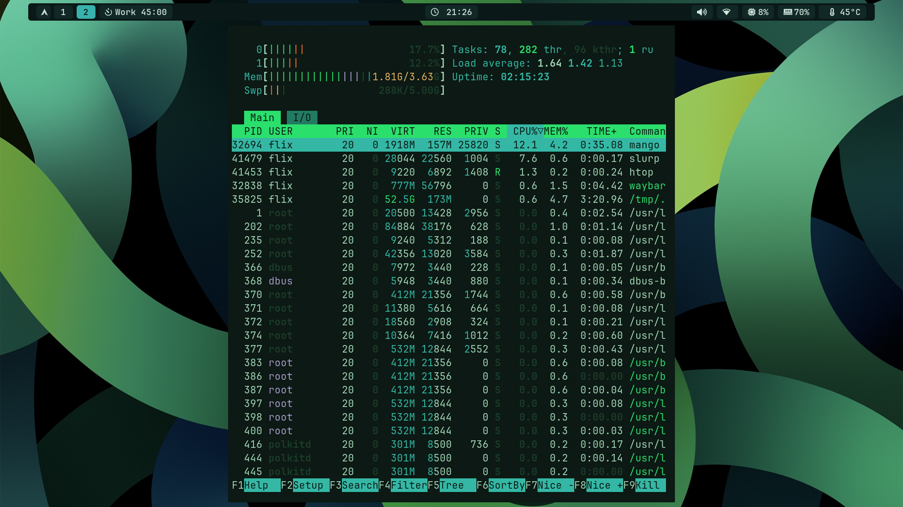
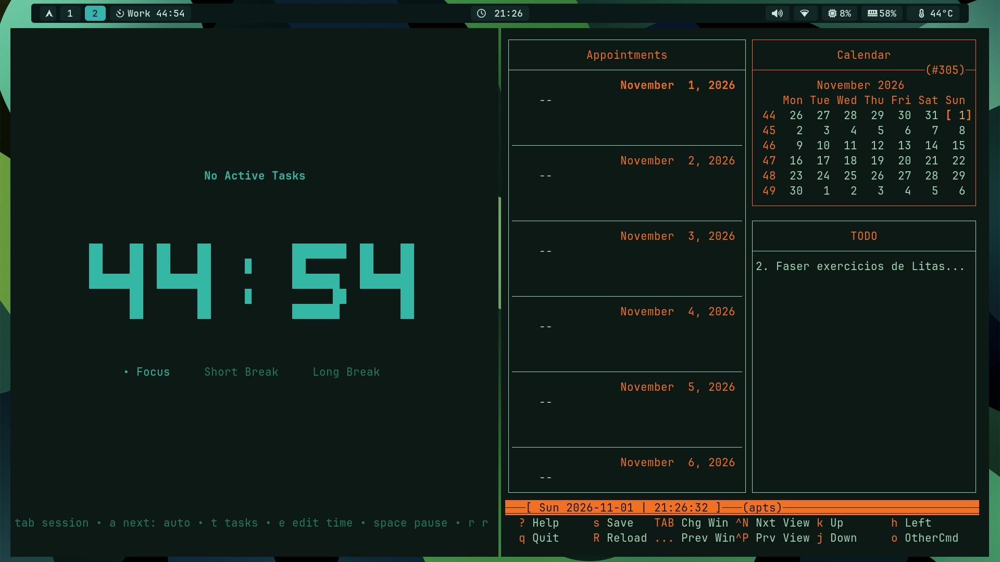
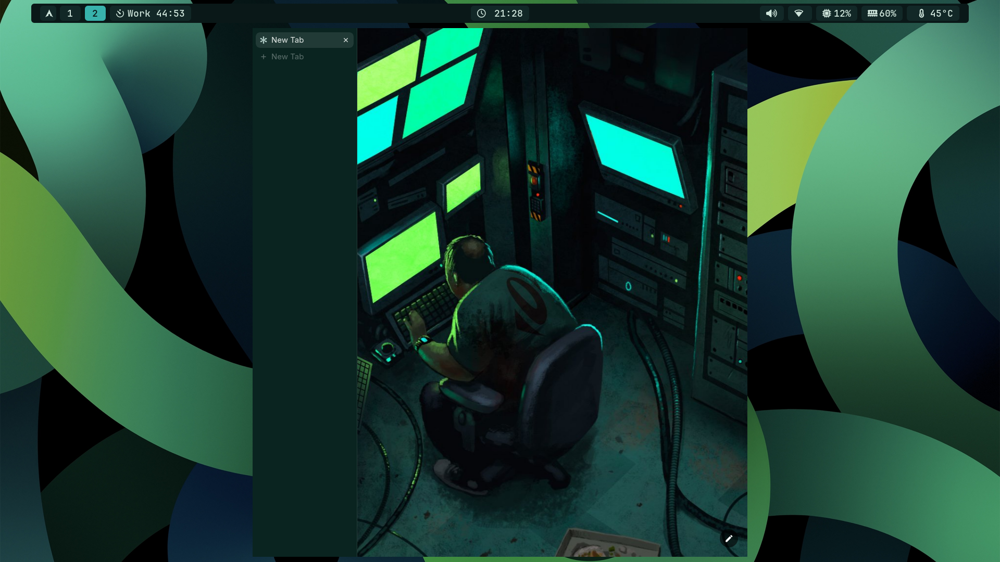

# 🌿 Flix — dotfiles

Setup minimalista em **Arch Linux** com **MangoWM** (Wayland), feito para correr leve em hardware modesto e pensado para desenvolvimento **backend**.

Tema verde, tudo no teclado, sem peso desnecessário.



---

## ✨ Destaques

- **Leve a sério**: ~840 MiB de RAM em idle, CPU a ~10% e ~43 °C num Celeron com 4 GB de RAM.
- **Workflow de foco**: pomodoro integrado na barra e num TUI próprio, com agenda e lista de tarefas ao lado.
- **Tudo em terminal**: editor, ficheiros, agenda, monitorização.
- **Tema coeso**: o wallpaper, a barra, o terminal e o Neovim partilham a mesma paleta verde.

---

## 🧩 Stack

| Função | Ferramenta |
| --- | --- |
| Sistema | Arch Linux |
| Compositor / WM | [MangoWM](https://github.com/DreamMaoMao/mangowc) (Wayland) |
| Barra | Waybar |
| Terminal | foot |
| Shell | zsh |
| Launcher | fuzzel |
| Editor | Neovim |
| Ficheiros | yazi |
| Browser | Helium |
| Agenda / tarefas | calcurse |
| Monitor de sistema | htop |
| Captura de ecrã | slurp |
| Extras | scrcpy, LocalSend |

---

## 🖥️ Hardware

Escolhido de propósito para provar que dá para ter um desktop bonito e rápido sem gastar muito.

| | |
| --- | --- |
| Máquina | Acer Aspire XC-830 |
| CPU | Intel Celeron J4025 (2 cores @ 2.90 GHz) |
| GPU | Intel UHD Graphics 600 (integrada) |
| RAM | 4 GB |

---

## 📸 Screenshots

### Neovim
Dashboard de arranque e editor lado a lado com o terminal.

| Dashboard | Editor + terminal |
| --- | --- |
|  |  |

### Launcher e monitorização

| fuzzel | htop |
| --- | --- |
|  |  |

### Foco e produtividade
Pomodoro, agenda, calendário e TODO num só workspace.



### Browser



---

## 📁 Estrutura

> Ajusta esta secção à estrutura real do repositório.

```
.
├── mango/        # config do MangoWM
├── waybar/       # barra e estilos
├── foot/         # terminal
├── fuzzel/       # launcher
├── nvim/         # Neovim
├── yazi/         # gestor de ficheiros
├── zsh/          # shell
└── assets/
    └── screenshots/
```

---

## 🚀 Instalação

### 1. Dependências

Pacotes dos repositórios oficiais:

```bash
sudo pacman -S foot waybar fuzzel yazi neovim zsh htop calcurse slurp scrcpy
```

Pacotes do AUR (com o teu helper preferido): **MangoWM**, **Helium** e **LocalSend**.

### 2. Clonar o repositório

```bash
git clone https://github.com/<teu-utilizador>/<teu-repo>.git ~/dotfiles
cd ~/dotfiles
```

### 3. Ligar as configurações

Usa links simbólicos (à mão ou com [GNU Stow](https://www.gnu.org/software/stow/)):

```bash
ln -s ~/dotfiles/waybar ~/.config/waybar
ln -s ~/dotfiles/foot   ~/.config/foot
# repete para as restantes pastas
```

Se já tens configs com o mesmo nome, faz backup antes.

### 4. Arrancar

Termina a sessão e inicia o **MangoWM** a partir do TTY ou do teu display manager.

---

## 🎯 Notas

- A config foi pensada para **hardware fraco**: sem animações pesadas e sem serviços em segundo plano a mais.
- Testado em monitor interno e em monitor externo por VGA.
- Se algo não funcionar na tua máquina, abre uma issue.

---

## 👤 Autor

**Helder Maneco ("Flix")** — Desenvolvedor Backend, Luanda 🇦🇴

APIs, sistemas robustos e muito terminal.

---

## 📄 Licença

MIT — usa, adapta e partilha à vontade.
